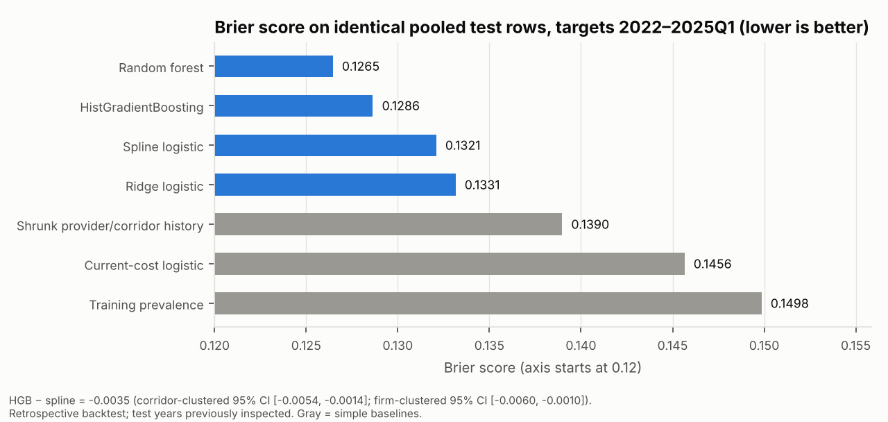
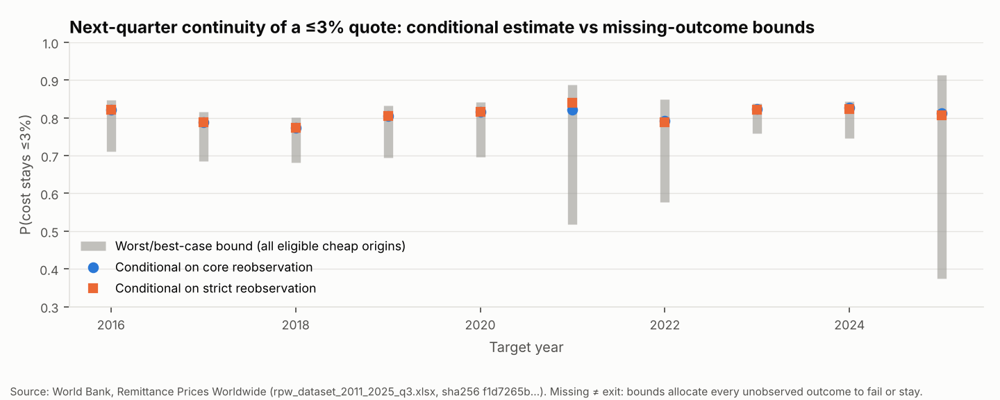

# Global remittance quote continuity (R01)

Investigator: Isaac Omoding · Research programme R01 · Stage: **phase-1 retrospective analysis, decision CONDITIONAL**

A surveyed money-transfer quote may cost ≤3% of the amount sent, the SDG 10.c reference level. This project asks two questions about such quotes in the World Bank's *Remittance Prices Worldwide* (RPW) survey:

- Does the **same surveyed service** still cost ≤3% when it is surveyed again in the **next calendar quarter**?
- How much does the answer depend on how "same service" is defined, and on quotes that simply are not observed again?

It also asks whether a model ranks quotes for analyst re-checking better than strong simple rules. The unit of analysis is a surveyed offer. It is not a price paid by a user, not a provider exit, and not consumer welfare.

## Research questions

1. Conditional continuity: P(cost at t+1 ≤ 3% | cost at t ≤ 3%, the same service is reobserved at exactly t+1).
2. Worst/best-case bounds on that probability when quotes that are not reobserved are counted as failures or successes.
3. Corridor level: does a corridor that had at least one surveyed ≤3% quote still have one next quarter?
4. Do ridge or spline logistic models, HistGradientBoosting or random forest beat history and cost rules in time-forward evaluation? The primary metric is Brier score, alongside calibration and review-capacity capture.

## Data

- Source: the World Bank RPW complete dataset ([catalogue](https://datacatalog.worldbank.org/search/dataset/0037898/remittance-prices-worldwide)), file `rpw_dataset_2011_2025_q3.xlsx`.
- Fetch: 17 Oct 2026, 50,780,339 bytes, sha256 `f1d7265b…82d2a8` (see [`results/source_manifest.json`](results/source_manifest.json)).
- Licence: the catalogue lists CC BY 4.0. The workbook's terms require attribution and reference a "restricted data" list, so **no row-level data is committed**.
- Coverage analysed: the post-Q2-2016 sheet, with 204,469 quotes over 2016Q2–2025Q3, 368 corridors and 699 normalised providers. **2025Q2 is absent from the source.**
- The 2011–2016Q1 sheet uses a different identity schema and is not linked.

## Design (frozen in [`configs/experiment.yaml`](configs/experiment.yaml) before any model metric)

- **Core identity:** corridor + provider (NFKC/casefold) + payment instrument + access point + pickup method + pickup location + USD basket.
- **Strict identity:** core plus unchanged speed and receiving-network coverage, evaluated on the same origin cohort.
- No fuzzy links. Keys duplicated within a quarter are excluded and counted. Only exactly adjacent quarters are linked.
- **Evaluation:** expanding window, refit per target year 2022/2023/2024/2025 (2025 contains 2025Q1 targets only). Training targets come strictly before the first test origin.
- **History features** use only transitions whose target quarter is ≤ origin − release lag. The primary run uses lag 0; lag 1 is a sensitivity analysis.
- **Uncertainty:** paired cluster bootstrap (1,000 reps) by corridor and, separately, by provider.

## Results (retrospective; all test years were inspected in the earlier pilot)

| Model (pooled 2022–2025Q1, n = 19,667, 329 corridors) | Brier | AUROC | Calibration slope | Failures caught at 20% review (of 3,605) |
|---|---|---|---|---|
| Training prevalence | 0.1498 | 0.515 | – | – |
| Highest current cost rule | – | – | – | 1,217 |
| Shrunk provider/corridor history | 0.1390 | 0.694 | 0.78 | 1,387 |
| Ridge logistic | 0.1331 | 0.736 | 0.78 | 1,620 |
| Spline logistic | 0.1321 | 0.743 | 0.78 | 1,618 |
| HistGradientBoosting | 0.1286 | 0.761 | 0.82 | 1,740 |
| Random forest | **0.1265** | 0.773 | 1.19 | 1,758 |

- **Boosting vs spline logistic:** −0.0035 Brier (corridor CI [−0.0054, −0.0014]).
- **Comparison with the pilot (2022–24):** −0.0026 here vs −0.0081 reported. The provider-clustered CI includes 0, and the spline won in 2024.
- **Reobservation:** a ridge model of whether a quote is reobserved did *not* beat prevalence in 2022 or 2023.
- **Missing-outcome bounds:** the conditional continuity rate is 0.81, but bounds over all eligible origins are [0.65, 0.85].
- **Uganda:** the receiving-Uganda subgroup (3 corridors, 20 failures) is too small for model claims.

Full detail, including the pilot comparison, is in [`docs/STATUS.md`](docs/STATUS.md).




## What is not claimed

- No consumer savings, market exit, or welfare effect.
- No prospective forecasting value: public release dates are not established, so lead time may be zero.
- No novelty claim yet: the competitor audit is pending.
- The service-level threshold rate is not the official SDG indicator.

## Reproduce

```bash
python -m venv .venv && . .venv/bin/activate && pip install -e ".[dev]"
python -m rpi.acquire                 # downloads the official workbook to data/raw (gitignored), checks sha256
export OMP_NUM_THREADS=2 OPENBLAS_NUM_THREADS=2
python -c "from rpi.preprocess import load_clean; load_clean(rebuild=True)"   # ~1 min
python -m rpi.audit
python scripts/run_phase1.py --release-lag 0      # ~2 min CPU
python scripts/run_phase1.py --release-lag 1
python scripts/run_descriptive.py
python scripts/subgroup_metrics.py
python -m rpi.figures
pytest -q                                         # synthetic fixtures only; no data needed
```

See [`docs/REPRODUCIBILITY.md`](docs/REPRODUCIBILITY.md). No dashboard has been deployed.

## Citation and acknowledgements

Data: *The World Bank, Remittance Prices Worldwide, available at http://remittanceprices.worldbank.org*. The World Bank does not endorse this analysis. AI assistance: code and documents in this branch were produced with Claude Code (Anthropic) under investigator direction, and must be disclosed in any manuscript.
