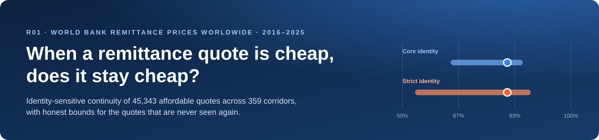
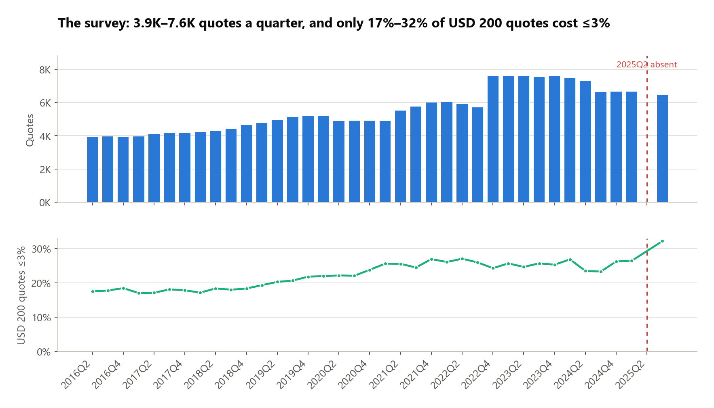
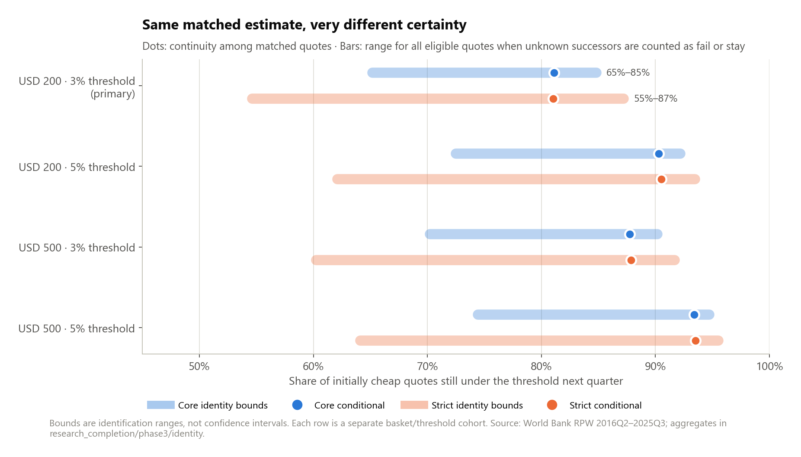
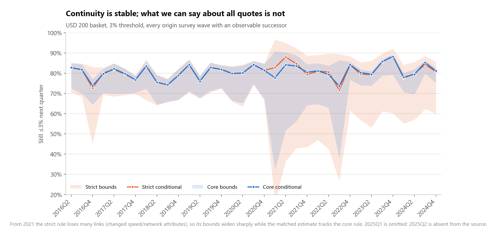
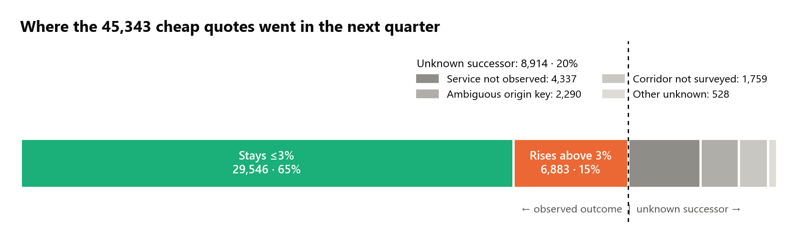
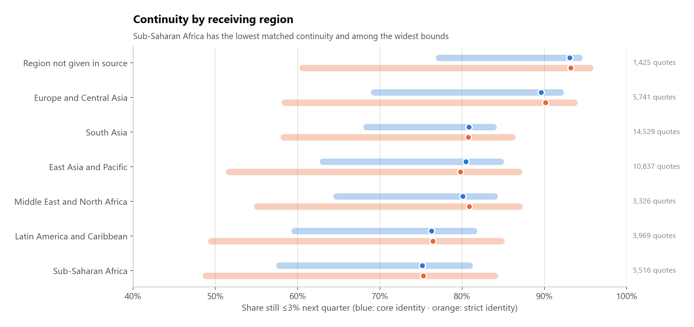
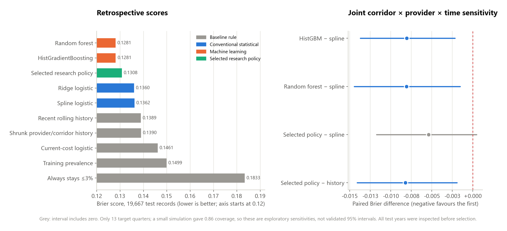
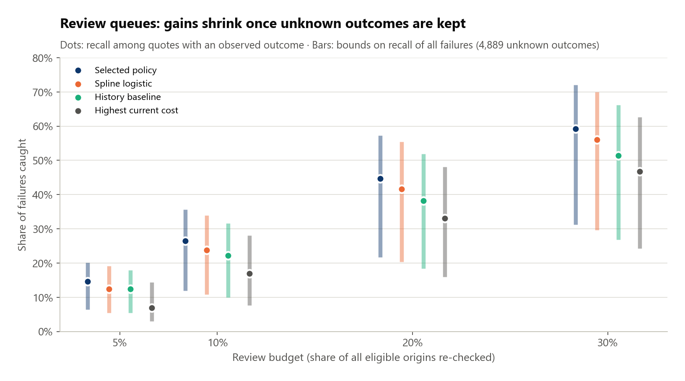
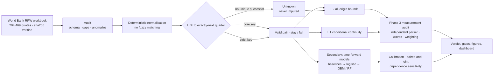

<p align="center">
  
</p>

<h1 align="center">Remittance quote continuity</h1>

<p align="center">
  <b>Identity-sensitive continuity and unknown-successor bounds for affordable money-transfer quotes<br>
  in the World Bank's <i>Remittance Prices Worldwide</i> survey, 2016–2025</b>
</p>

<p align="center">
  <a href="https://github.com/Isaac25-lgtm/remittance-price-intelligence/actions/workflows/ci.yml"></a>
  
  
  
  
  
  <a href="https://isaac-remittance-research.streamlit.app/"></a>
</p>

<p align="center">
  <a href="https://isaac-remittance-research.streamlit.app/"><b>Open the research dashboard</b></a> ·
  <a href="research_completion/phase3/START_HERE_PHASE3.md">Phase 3 dossier</a> ·
  <a href="research_completion/phase3/assessment/FINAL_SCIENTIFIC_VERDICT.md">Scientific verdict</a> ·
  <a href="#reproduce-it">Reproduce</a>
</p>

> [!IMPORTANT]
> **Read this first.** The unit is a *surveyed offer*, not a price anyone paid. A quote that is not seen again has
> not necessarily left the market. The analysis is retrospective: every test year was inspected before the final
> model selection, and the historical release dates of survey waves cannot be verified. **No operational model is
> claimed, the work has not been peer reviewed, and the current decision is `CONDITIONAL_HOLD`.**

---

## At a glance

| | Result | What it is |
|---|---|---|
| **81.1%** | 29,546 of 36,429 matched quotes stay ≤3% | Continuity among cheap quotes whose exact service is found again next quarter |
| **65.2% – 84.8%** | 8,914 of 45,343 cheap quotes have no observable successor | Range the all-quote share must lie in, with no assumption about the missing |
| **+12.9 pp** | Strict identity: 54.6% – 87.2% | Extra width when a change in speed or network breaks the link; the matched estimate barely moves (81.0%) |
| **92.2%** | 8,189 of 8,879 resurveyed corridor-quarters | Corridors still showing at least one surveyed quote ≤3%: a monitoring quantity, not the same offer |
| **0.1308** | Selected policy Brier (raw ML ≈ 0.1281) | Retrospective model scores; superiority over a spline logistic is not robust |

## Background

**Remittances** are the money migrants send home. For many households in low- and middle-income countries they pay
for food, school fees and health care, so the share lost to fees and exchange-rate margins matters. The
Sustainable Development Goals (target **10.c**) aim to bring the cost of sending remittances **below 3%** by 2030 and
to eliminate corridors costing more than 5%.

The World Bank's **[Remittance Prices Worldwide](https://remittanceprices.worldbank.org)** (RPW) survey is the main
evidence base. Each quarter it records the total cost (fee plus exchange-rate margin) of sending USD 200 and USD 500
through named services in each sending→receiving corridor. The post-2016 file used here holds **204,469 quotes**
from **368 corridors** (48 sending and 105 receiving countries) and **699 normalised provider labels**.



Official indicators summarise **corridor averages**. They do not tell an analyst, a regulator or a migrant whether a
*specific* cheap service is still cheap three months later, or how often it simply cannot be found again. That gap
is what this project measures.

## The questions

1. **Continuity.** If a surveyed quote costs ≤3% in quarter *t*, does the *same service* still cost ≤3% in the
   exactly-next calendar quarter?
2. **Identity.** How much does the answer depend on what counts as "the same service"?
3. **Missingness.** What can honestly be said about the quotes that are never reobserved, without assuming why?
4. **Prediction (secondary).** Do statistical or machine-learning models rank quotes for analyst re-checking better
   than simple rules?

## Key findings

### 1. Same matched estimate, very different certainty



Two identity rules are compared on the **same 45,343 eligible quotes**:

- **Core** matches corridor, provider, payment instrument, access point, pickup method, pickup location and basket.
- **Strict** also requires unchanged transfer speed and receiving-network coverage.

The matched (conditional) estimate is almost identical under both rules: **81.11% vs 81.05%**. The range for *all*
eligible quotes, however, widens from **65.2–84.8%** to **54.6–87.2%**, an extra **12.9 percentage points**. The strict
bounds are wider in **35 of 36** origin waves and narrower in none. A claim such as "four in five cheap services stay
cheap" is therefore only defensible *conditional on being matched*. For all cheap quotes, it is not identified.

### 2. The widening is concentrated after 2020



From the 2021Q1 origin wave onward, many successors change recorded speed or network attributes. The core rule
still links them; the strict rule does not, so its bounds open up while its matched estimate tracks the core line.

### 3. One in five cheap quotes has no observable successor



Unknown is not failure. These quotes may have been dropped from the survey, relabelled, matched ambiguously or
recorded with an invalid cost. The study never assumes which.

### 4. Lower continuity, wider bounds in Sub-Saharan Africa



Weighting matters too. Giving every corridor equal weight gives **69.5%**, and every provider label **63.2%**, against
81.1% weighted by quote. These are different estimands, not corrections. Uganda-receiving corridors (3 corridors,
20 failures) fall below the pre-specified support gate, and no corridor in the source sends *from* Uganda.

### 5. Models: a small, fragile gain over simple rules



Fourteen model variants were scored on the same 19,667 retrospective test records: baselines, ridge and spline
logistic regression, gradient boosting and random forest, raw and calibrated. Raw random forest and gradient boosting
record the lowest Brier scores (≈0.1281). The pre-specified selected research policy scores **0.1308**.

The joint corridor × provider × time interval for *selected policy − spline* is **[−0.0117, +0.0005]**, which
includes zero. Only 13 target quarters are available, and a small simulation gave 0.86 coverage, so no robust
superiority is claimed.

### 6. Review queues: gains shrink once unknown outcomes are kept



Earlier queues ranked only quotes that were later reobserved, which conditions on the future. Scored over **all**
eligible origins, the selected policy's recall at a 20% review budget is bounded between **21.7% and 57.3%**, and the
bounds overlap heavily across rules. A separate model of *whether* a quote is reobserved did not beat simple
prevalence in 2022 or 2023. That negative result is kept.

## What is already known

| Work | What it did | How this project differs |
|---|---|---|
| Beck & Martínez Pería 2011, *World Bank Econ. Rev.* [doi:10.1093/wber/lhr017](https://doi.org/10.1093/wber/lhr017) | Explained corridor-level remittance prices across 119 corridors | Corridor averages, not same-service continuity |
| Beck, Janfils & Kpodar 2022, IMF WP 2022/063 [doi:10.5089/9798400205439.001.a001](https://doi.org/10.5089/9798400205439.001.a001) | Firm-level panel regressions on RPW fees | Explanatory, contemporaneous; no linked continuity panel |
| Borra & Saritha 2026 | Provider and channel composition in the Kuwait–India corridor | Single corridor; pricing levels, not persistence |
| Lim 2026, SSRN [doi:10.2139/ssrn.6830281](https://doi.org/10.2139/ssrn.6830281) | Digital discount in RPW, 2016–2025 | **Full text not obtained, so overlap is unverified.** This is the main open novelty gate |
| Nakamura & Steinsson 2012, *AER* [doi:10.1257/aer.102.7.3277](https://doi.org/10.1257/aer.102.7.3277) | Product-replacement bias in matched-item price indices | Closest conceptual precedent; the matched-item selection lesson is theirs |
| Horowitz & Manski 1998, *J. Econometrics* [doi:10.1016/S0304-4076(97)00077-8](https://doi.org/10.1016/S0304-4076(97)00077-8) | Worst-case bounds under survey nonresponse | The bounding method is established; this project applies it |

The contribution is a careful **domain measurement**: how identity rules and unknown successors change what can
be said about affordable RPW quotes. It does not offer a new method or a forecasting system. The full matrix,
access log and novelty decision are in
[`research_completion/phase3/literature/`](research_completion/phase3/literature/NOVELTY_DECISION.md).

## How it works



| Element | Choice |
|---|---|
| Unit | One surveyed quote (corridor × provider × service bundle × basket × quarter) |
| Eligible | USD 200 basket, total cost 0–3%, target quarter observed in the source |
| Outcome | Same service, exactly-next calendar quarter, still ≤3% |
| Estimands | E1 conditional continuity · E2 all-origin bounds · E3 corridor-level ≥1 cheap quote · E4 reobservation |
| Identity | Core (primary) and strict (sensitivity) on the same eligible cohort |
| Secondary products | 5% threshold; USD 500 basket |
| Models | 8 frozen families + rolling-history reference + calibrated variants + one selected research policy |
| Splits | Expanding window by target year 2022–2025Q1; chronological tuning, calibration and selection windows |
| Uncertainty | Corridor and provider cluster bootstrap; crossed corridor × provider × time blocks; wave-level HAC sensitivities |
| Protocol | Frozen before metrics in [`configs/experiment.yaml`](configs/experiment.yaml); amendments dated in [`docs/DECISION_LOG.md`](docs/DECISION_LOG.md) and [`research_completion/phase3/AMENDMENTS.md`](research_completion/phase3/AMENDMENTS.md) |

## Verdict and publication gates

**`CONDITIONAL_HOLD`.** The measurement result is real and reproducible, but two external gates stay open:

| Gate | Status |
|---|---|
| Independent source and count reproduction (20 of 20 checks) | ✅ Pass |
| Recorded-key measurement definitions (E1–E4 kept separate) | ✅ Pass, conditional on rule |
| Finite-panel measurement robustness | ✅ Pass, with scope limits |
| Strict 1e-9 numerical identity with the legacy run | ❌ Fail, retained and documented |
| Historical information clocks (forecast lead time) | ❌ Fail, so there is no predictive track |
| Robust model superiority and operational value | ❌ Not established |
| Substantial claim-specific novelty (Lim 2026 full text) | ⏳ Unresolved |
| External economic-service identity validation (60 blinded cases prepared) | ⏳ Unresolved, needs human review |
| Submission-ready manuscript | ⏳ Not justified yet |

**Next step:** a lawful full-text overlap review of Lim (2026) and a blinded human review of the 60 prepared
identity cases. If either fails, archive the original-article route; if both clear, write a measurement-focused
manuscript from the [conditional dossier](research_completion/phase3/manuscript/conditional_research_dossier.md).
The full matrix is in [`PUBLICATION_GATE_MATRIX.csv`](research_completion/phase3/assessment/PUBLICATION_GATE_MATRIX.csv).

## Research dashboard

**[isaac-remittance-research.streamlit.app](https://isaac-remittance-research.streamlit.app/)** is a 14-page
interactive companion to this README: overview, background and concepts, data provenance, linkage and identity,
continuity bounds, the Phase 3 measurement audit, model comparison, time-forward and lag sensitivity, calibration,
review capacity, the negative reobservation result, geography and support gates, the verdict, and reproducibility.

It is built with **Streamlit and Plotly** and reads only an allowlist of committed aggregate CSVs. It never
trains a model, downloads the source or touches row-level data. Every chart has a "Data behind this view" panel
that downloads the exact committed file. Details: [`dashboard/README.md`](dashboard/README.md) and
[`docs/DEPLOYMENT.md`](docs/DEPLOYMENT.md).

```bash
pip install -r dashboard/requirements.txt
streamlit run dashboard/app.py
```

## Reproduce it

```bash
git clone https://github.com/Isaac25-lgtm/remittance-price-intelligence.git
cd remittance-price-intelligence
python -m venv .venv
# Windows PowerShell:  .venv\Scripts\Activate.ps1      Linux / macOS:  source .venv/bin/activate
python -m pip install -e ".[dev,dashboard]"
python -m pytest -q tests research_completion/phase3/code/test_science.py   # fixtures, integrity, dashboard

# Real data (public, about 50 MB; checksum-verified, never committed)
export OMP_NUM_THREADS=2 OPENBLAS_NUM_THREADS=2
python -m rpi.acquire                          # fetch + sha256 check
python scripts/reproduce_from_cache.py         # Phase 1 pipeline, compares frozen tables
python research_completion/phase3/code/run.py independent_measurement \
       python research_completion/phase3/code/measurement.py   # Phase 3 measurement audit (logged)
python scripts/readme_figures.py               # regenerate the figures in this README
```

The remaining Phase 3 stages are listed in the [supplementary methods](research_completion/phase3/manuscript/supplementary_methods.md). The Phase 2 completion pipeline, with exact command order, thread limits and expected (documented) failures, is in
[`research_completion/reproducibility/README.md`](research_completion/reproducibility/README.md). Raw rows, row-level
predictions, fitted models and copyrighted PDFs are excluded from Git by design.

## Limitations

1. **No verified lead time.** Historical RPW release dates could not be reconstructed, so there is no forecasting or
   operational claim.
2. **All test years were inspected** before Phase 2 selection, and no untouched later wave exists yet.
3. **Exact-key identity** probably under-links renamed services and may merge distinct offerings, and no human
   adjudication has been done yet.
4. **Unknown ≠ exit.** Missing successors can reflect survey coverage, metadata changes or price availability.
5. **Few independent waves.** There are 13 target quarters for model comparisons and 36 origin waves for
   measurement, so the reported intervals are sensitivities rather than validated 95% intervals.
6. **Survey offers, not transactions.** Quote weights are not volumes, and Uganda subgroups are below the support gates.

More detail: [`docs/LIMITATIONS.md`](docs/LIMITATIONS.md) and the
[scientific audit](research_completion/phase3/assessment/SCIENTIFIC_AUDIT.md).

## Repository map

| Path | Contents |
|---|---|
| [`src/rpi/`](src/rpi) | Acquisition, audit, preprocessing, linkage, features, models, evaluation |
| [`scripts/`](scripts) | Phase 1 and 2 pipelines, reproduction, audits, README figures |
| [`configs/`](configs) | Frozen experiment and Phase 2 publication configurations |
| [`results/`](results) | Frozen Phase 1 aggregate tables, figures and reproduction report |
| [`research_completion/`](research_completion) | Phase 2 completion: models, inference, literature, gates, handoff |
| [`research_completion/phase3/`](research_completion/phase3) | Phase 3 measurement audit, identity review protocol, dossier, verdict |
| [`dashboard/`](dashboard) | Streamlit + Plotly research dashboard (aggregates only) |
| [`docs/`](docs) | Protocol, data dictionary, model card, decisions, deployment, figures, archive |
| [`tests/`](tests) | Leakage, linkage, metric, integrity and dashboard tests on fixtures and committed aggregates |

**Project history.** Phase 1 (17 Oct 2026) froze the protocol and ran the first retrospective backtest. Phase 2
(20–21 Oct) added chronological selection, calibration, joint-dependence sensitivity and all-origin capacity bounds.
Phase 3 (21 Oct) added an independent measurement audit and the conditional dossier. The earlier README, with every
Phase 1 and 2 number, is preserved in
[`docs/archive/README_phase1_phase2_record.md`](docs/archive/README_phase1_phase2_record.md).

## Citation and acknowledgements

Omoding I. *Remittance quote continuity: identity-sensitive continuity and unknown-successor bounds in World Bank
Remittance Prices Worldwide* (research software and dossier, R01), 2026.
https://github.com/Isaac25-lgtm/remittance-price-intelligence. See [`CITATION.cff`](CITATION.cff).

**Data:** *The World Bank, Remittance Prices Worldwide, available at http://remittanceprices.worldbank.org*
(CC BY 4.0). The World Bank does not endorse this analysis.

**AI assistance:** code, analysis checks and documents were produced with Claude Code (Anthropic) under investigator
direction. This must be disclosed in any manuscript, and every result requires human scientific verification.
