# Figure legends

All figures use World Bank RPW aggregates, generated from the stated tables. PNG files are 300 dpi; SVG text remains editable. No source microdata are distributed.

## 1. Exact-quarter quote flow and observation uncertainty
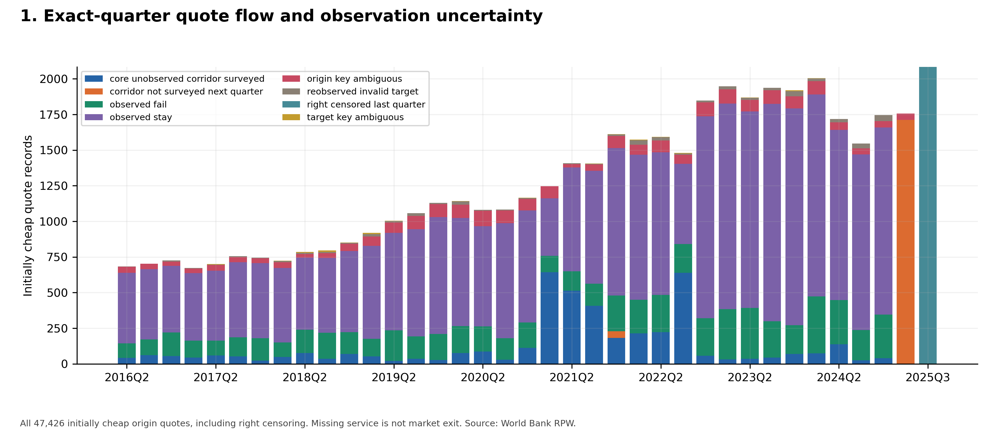
Source: `data/inclusion_exclusion_flow.csv`. All 47,426 initially cheap origin quotes, including right censoring. Missing service is not market exit. Source: World Bank RPW.

## 2. Survey coverage and composition across 37 observed waves
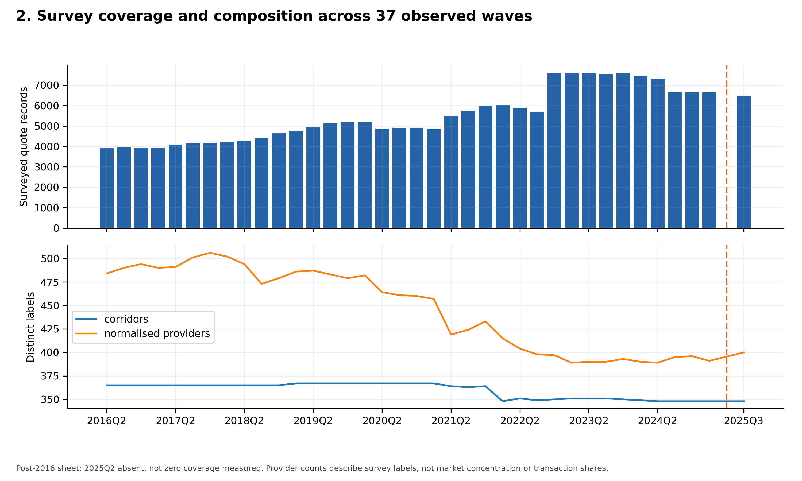
Source: `data/cohort_by_wave.csv`. Post-2016 sheet; 2025Q2 absent, not zero coverage measured. Provider counts describe survey labels, not market concentration or transaction shares.

## 3. Conditional continuity and partially identified population bounds
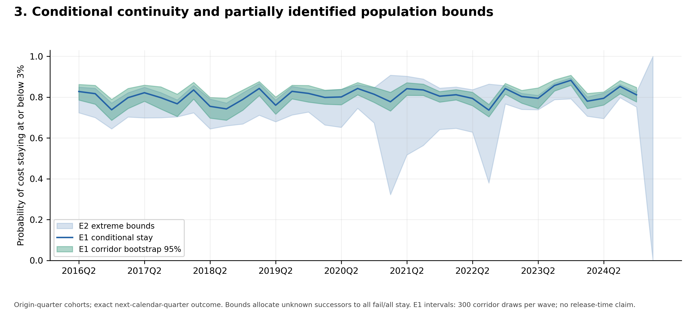
Source: `tables/table_03_persistence_bounds.csv`. Origin-quarter cohorts; exact next-calendar-quarter outcome. Bounds allocate unknown successors to all fail/all stay. E1 intervals: 300 corridor draws per wave; no release-time claim.

## 4. Cost movement and threshold proximity
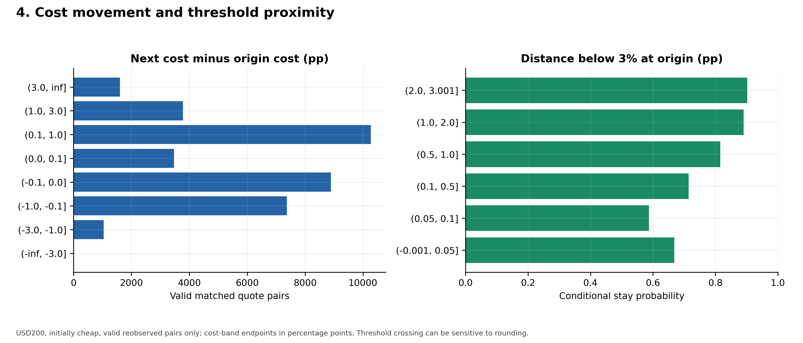
Source: `tables/supplementary_cost_transitions.csv; supplementary_threshold_margin.csv`. USD200, initially cheap, valid reobserved pairs only; cost-band endpoints in percentage points. Threshold crossing can be sensitive to rounding.

## 5. Conventional and ML probability comparisons
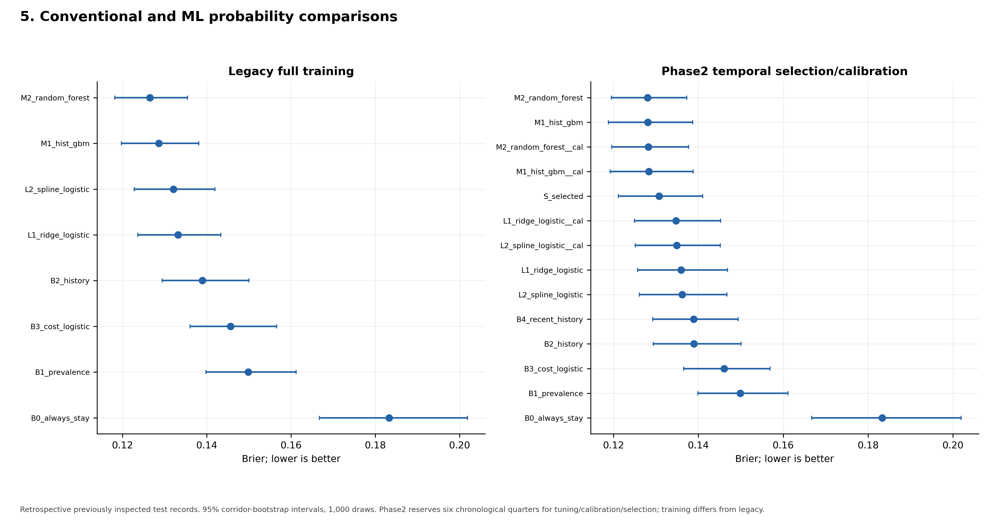
Source: `models/absolute_brier_ci.csv`. Retrospective previously inspected test records. 95% corridor-bootstrap intervals, 1,000 draws. Phase2 reserves six chronological quarters for tuning/calibration/selection; training differs from legacy.

## 6. Reliability on retrospective outer test records
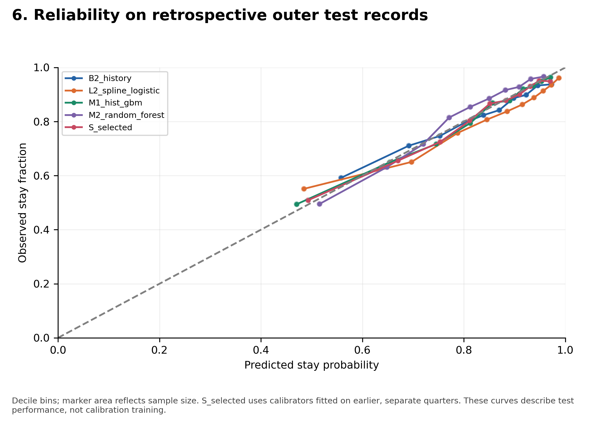
Source: `models/calibration.csv`. Decile bins; marker area reflects sample size. S_selected uses calibrators fitted on earlier, separate quarters. These curves describe test performance, not calibration training.

## 7. Conditional matched-sample analyst review benchmark
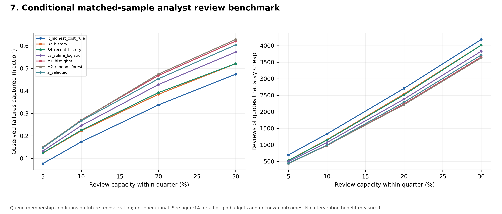
Source: `models/decision_capacity.csv`. Queue membership conditions on future reobservation; not operational. See figure14 for all-origin budgets and unknown outcomes. No intervention benefit measured.

## 8. African subgroup support and limitations
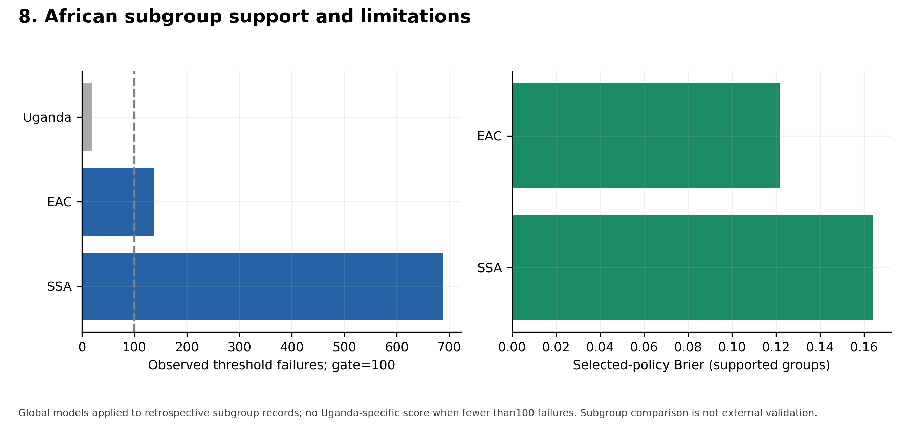
Source: `models/subgroups.csv`. Global models applied to retrospective subgroup records; no Uganda-specific score when fewer than100 failures. Subgroup comparison is not external validation.

## 9. Identity, threshold, basket and attrition sensitivities
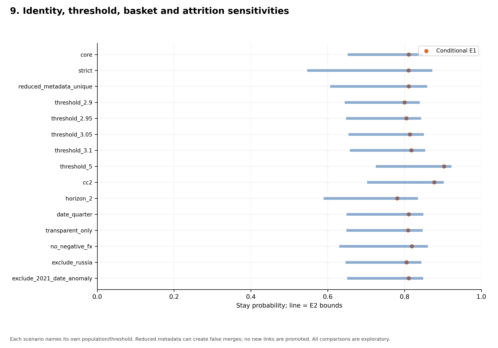
Source: `models/sensitivity_grid.csv`. Each scenario names its own population/threshold. Reduced metadata can create false merges; no new links are promoted. All comparisons are exploratory.

## 10. Dependence-aware uncertainty sensitivity
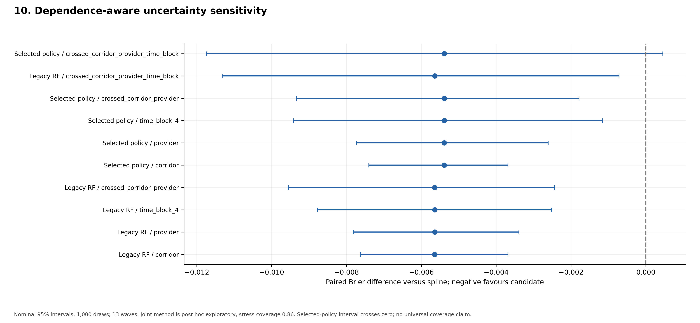
Source: `models/paired_dependence.csv; models/joint_dependence_sensitivity.csv`. Nominal 95% intervals, 1,000 draws; 13 waves. Joint method is post hoc exploratory, stress coverage 0.86. Selected-policy interval crosses zero; no universal coverage claim.

## 11. Associative feature-group diagnostics across 2024 quarters
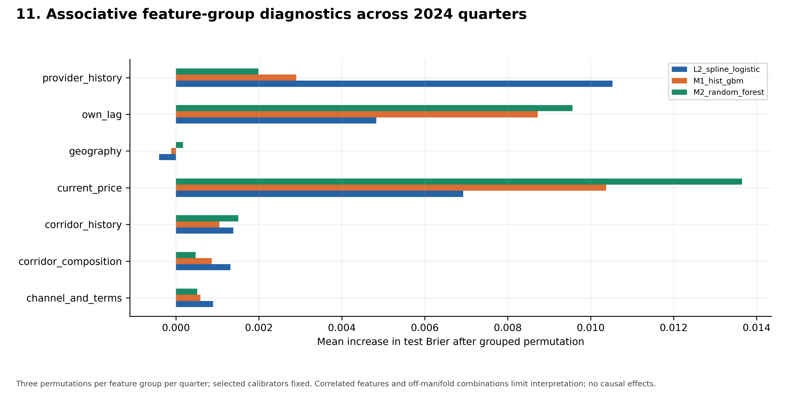
Source: `models/permutation_importance.csv`. Three permutations per feature group per quarter; selected calibrators fixed. Correlated features and off-manifold combinations limit interpretation; no causal effects.

## 12. Evidence gates determine the supported study scope
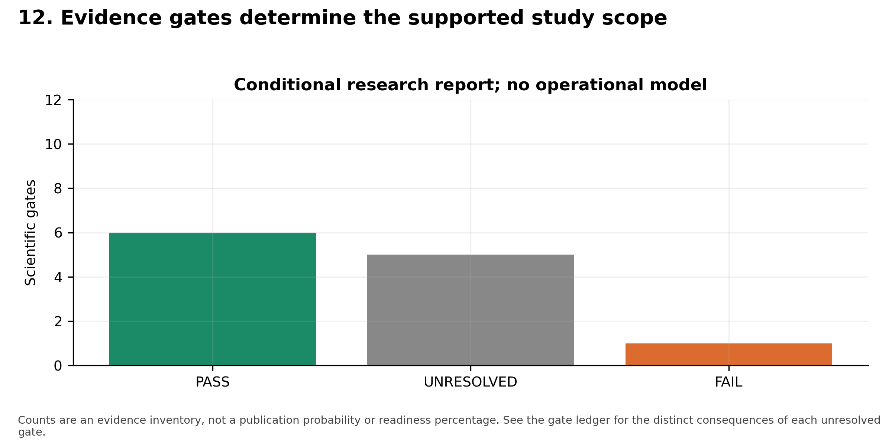
Source: `assessment/publication_gates.csv`. Counts are an evidence inventory, not a publication probability or readiness percentage. See the gate ledger for the distinct consequences of each unresolved gate.

## 13. Legacy versus phase2 (20 October 2026)
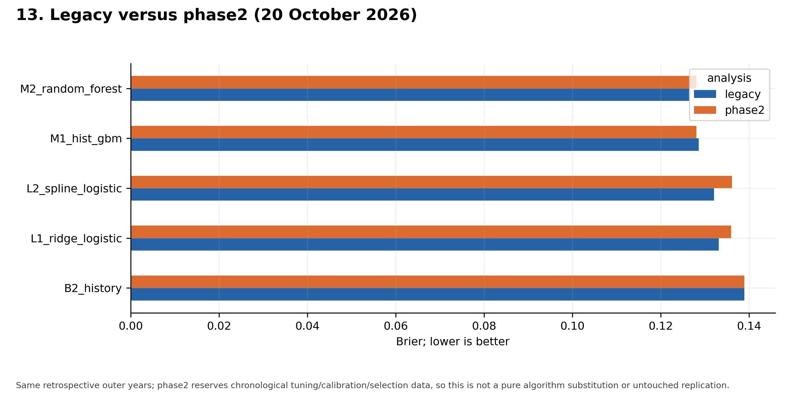
Source: `models/absolute_brier_ci.csv`. Same retrospective outer years; phase2 reserves chronological tuning/calibration/selection data, so this is not a pure algorithm substitution or untouched replication.

## 14. All-origin review budgets preserve unknown outcomes
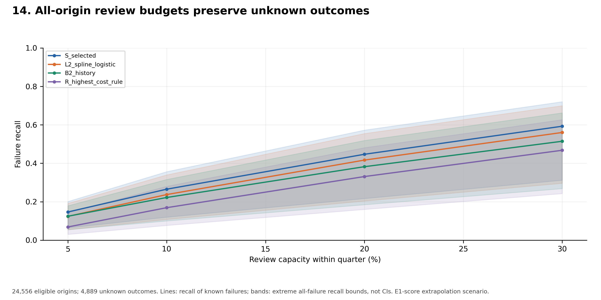
Source: `models/all_origin_capacity_bounds.csv`. 24,556 eligible origins; 4,889 unknown outcomes. Lines: recall of known failures; bands: extreme all-failure recall bounds, not CIs. E1-score extrapolation scenario.

## 15. Annual probability scores preserve negative and changing results
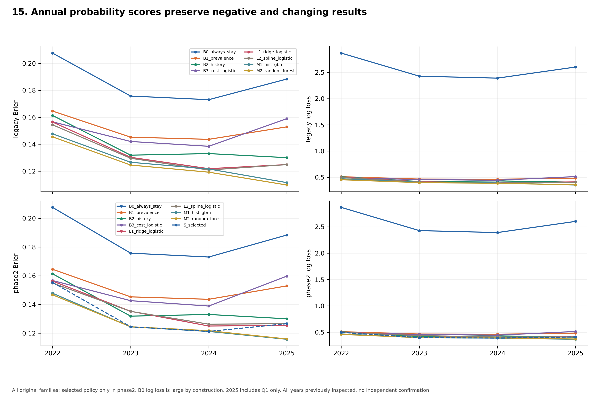
Source: `models/performance_by_year.csv`. All original families; selected policy only in phase2. B0 log loss is large by construction. 2025 includes Q1 only. All years previously inspected, no independent confirmation.

## 16. History lag sensitivity is not public release validation
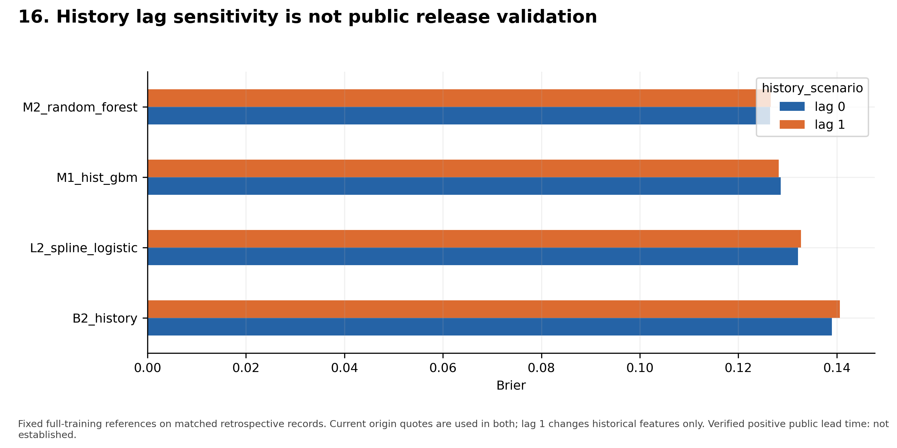
Source: `models/absolute_brier_ci.csv; models/transfer_sensitivity_metrics.csv`. Fixed full-training references on matched retrospective records. Current origin quotes are used in both; lag 1 changes historical features only. Verified positive public lead time: not established.
