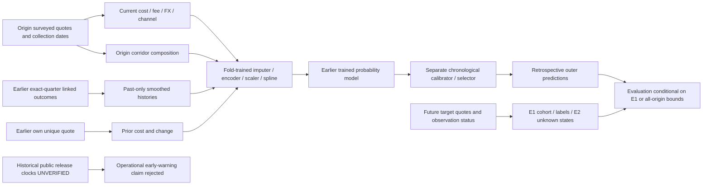

# Feature information graph

No arrow from future outcomes/status into admissible features. Whole-origin-wave composition is only retrospectively available here. All heldout-group target outcomes are removed from historical event pools. E1 membership itself depends on future reobservation and is explicitly an evaluation selection; the corrected all-origin review scenario preserves unknown states. Public release timing remains a separate failed forecasting gate. See feature_asof_registry.csv and the executable leakage/future-clock tests.
